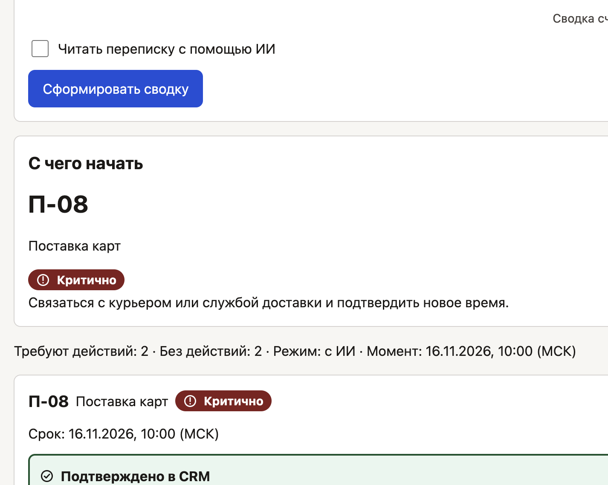
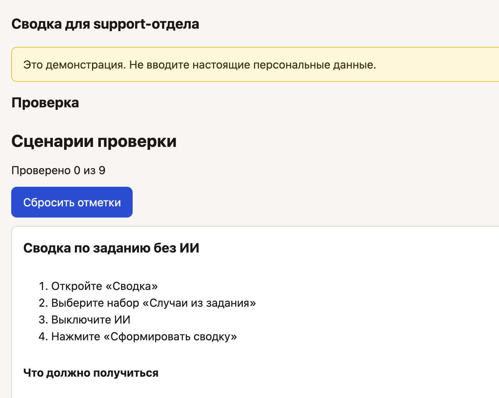

# Инструкция

## Что это

Приложение готовит ежедневную сводку для support-отдела. Здесь можно проверить решение тестового задания.

## Самый простой способ — по ссылке

Ссылка: <будет добавлена на этапе 8>

Сайт закрыт паролем. Браузер спросит имя и пароль. Пароль пришлёт разработчик, имя можно вписать любое.

## Запуск на своём компьютере

1. Установите Docker Desktop с сайта https://www.docker.com/products/docker-desktop/.
2. Запустите Docker Desktop и дождитесь, пока он загрузится.
3. Скачайте проект архивом и распакуйте его. Дальше работайте в распакованной папке.
4. На компьютере Mac дважды щёлкните файл «start.command». Если macOS пишет, что не может проверить разработчика, щёлкните по файлу правой кнопкой, выберите «Открыть» и подтвердите.
5. На компьютере Windows дважды щёлкните файл «start.bat». Если появилось окно «Windows защитила ваш компьютер», нажмите «Подробнее», затем «Выполнить в любом случае».
6. Дождитесь, пока откроется браузер. Окно с текстом не закрывайте раньше времени. Чтобы закрыть его после открытия страницы, нажмите Enter.

Так выглядит страница:

На жёлтой плашке написано не вводить настоящие персональные данные. Так и сделайте.

## Как остановить

На Mac дважды щёлкните файл «stop.command». На Windows дважды щёлкните файл «stop.bat».

Появится текст «Приложение остановлено. Данные сохранены». Нажмите Enter, чтобы закрыть окно.

## Как включить ИИ

ИИ нужен не для каждой проверки. Включите его, если на странице «Проверка» у сценария написано «Нужен ИИ».

1. Откройте раздел «Подключение ИИ» вверху страницы.
2. Выберите службу, вставьте ключ и напишите название модели. Эти три значения присылает разработчик. В файлы на компьютере их записывать не нужно.
3. Нажмите «Сохранить». Ключ после этого на странице больше не виден.
4. Вернитесь в «Сводку», включите «Читать переписку с помощью ИИ» и нажмите «Сформировать сводку».

## Как проверить задание

1. Откройте раздел «Проверка» вверху страницы.
2. Идите по сценариям сверху вниз. У каждого написано, что нажать и что должно получиться.
3. Если результат совпал, поставьте галочку «Проверено».
4. Если результат другой, на сводке нажмите «Ошибка» и напишите, что не так.

## Если что-то не работает

| Что видите | Что сделать |
| --- | --- |
| «Не найден Docker Desktop» | Установите Docker Desktop по ссылке из раздела про запуск. Запустите его и снова дважды щёлкните «start.command» или «start.bat». |
| «Docker Desktop не запущен» | Откройте Docker Desktop, дождитесь зелёного статуса и снова откройте тот же файл запуска. |
| «Порт 8080 занят другой программой» | Откройте файл «.env» в TextEdit или Блокноте. На Mac в окне «Открыть» нажмите Command, Shift и точку, если файла не видно. Замените строку APP_PORT=8080 на APP_PORT=8090. Сохраните файл и снова откройте файл запуска. В браузере откройте адрес http://localhost:8090. |
| Браузер сам не открылся | В окне запуска написан адрес страницы. Откройте его в браузере вручную. Обычно это http://localhost:8080. |
| Страница долго не открывается при первом запуске | Подождите. Первый запуск скачивает части программы. Это может занять несколько минут. Окно не закрывайте. |
